# SaaS Month-End Close Reconciliation Agent

A Slack bot that acts as an AI finance controller for month-end close. Drop a GL export CSV into Slack — the agent matches it against the AP subledger, surfaces exceptions with confidence scores and plain English reasoning, catches duplicate payments, requests human approval before posting any entry, and maintains an immutable audit trail of every action.




---

## What it does

1. Controller drops `march_gl_export.csv` into Slack
2. Agent confirms receipt, announces what it's doing
3. Threaded progress updates narrate the work in real time
4. Exception cards surface for each unmatched entry — confidence score + reasoning
5. For actionable exceptions: interactive Yes/No approval buttons
6. Agent catches a suspected duplicate Rippling payroll ($12,400 + $12,250, same payroll run, different refs)
7. Controller asks follow-up questions in natural language
8. Every action is logged to an immutable audit trail

---

## Project structure

```
recon-agent/
├── main.py                  # Slack bot, event routing, workflow orchestration
├── matching.py              # Layer 1 deterministic + duplicate detection
├── llm.py                   # Claude exception analysis + Q&A
├── database.py              # SQLite schema + audit log write guard
├── actions.py               # Human-in-the-loop button handlers
├── data/
│   ├── generate_fixtures.py # Generates CSVs + seeds audit log
│   ├── march_gl_export.csv  # 52 GL entries (generated)
│   ├── march_ap_subledger.csv
│   └── march_bank_statement.csv
├── requirements.txt
├── .env.example
├── recon-agent.service      # systemd service
├── nginx.conf               # nginx reverse proxy
└── README.md
```

---

## 1. Slack app setup

### Create the app

1. Go to [api.slack.com/apps](https://api.slack.com/apps) → **Create New App** → **From scratch**
2. Name it `Recon Agent`, choose your workspace

### OAuth scopes (Bot Token Scopes)

Go to **OAuth & Permissions** → **Scopes** → **Bot Token Scopes** and add:

| Scope | Purpose |
|---|---|
| `chat:write` | Post messages and thread replies |
| `files:read` | Download the uploaded GL CSV |
| `channels:history` | Read messages in channels |
| `app_mentions:read` | Receive @-mention events |
| `users:read` | (Production) Resolve Slack user IDs to emails |

Click **Install to Workspace** and copy the **Bot User OAuth Token** (`xoxb-...`).

### Event subscriptions

Go to **Event Subscriptions** → **Enable Events** → set Request URL:

- Local dev: `https://YOUR-NGROK-URL/slack/events`
- VPS: `https://YOUR-DOMAIN/slack/events`

Under **Subscribe to bot events**, add:
- `message.channels`
- `file_shared`
- `app_mention`

### Interactivity (for Yes/No buttons)

Go to **Interactivity & Shortcuts** → **Interactivity** → enable → set Request URL:

- Local dev: `https://YOUR-NGROK-URL/slack/actions`
- VPS: `https://YOUR-DOMAIN/slack/actions`

### Invite the bot to your channel

```
/invite @Recon Agent
```

---

## 2. Local dev with ngrok

### Install dependencies

```bash
python3 -m venv venv
source venv/bin/activate
pip install -r requirements.txt
```

### Set environment variables

```bash
cp .env.example .env
# Edit .env with your Slack tokens and Anthropic key
```

### Generate synthetic data

```bash
python data/generate_fixtures.py
```

This creates the three CSVs and pre-seeds the audit log (AWS amendment scenario).

### Start ngrok

```bash
ngrok http 3000
```

Copy the `https://xxxx.ngrok.io` URL. Go to your Slack app config and update:
- **Event Subscriptions** request URL → `https://xxxx.ngrok.io/slack/events`
- **Interactivity** request URL → `https://xxxx.ngrok.io/slack/actions`

Slack will send a `url_verification` challenge — the bot handles it automatically.

> **Note:** ngrok free tier generates a new URL each restart. Update both Slack URLs each time you restart ngrok.

### Start the bot

```bash
python main.py
```

You should see: `Recon agent starting on port 3000`

---

## 3. VPS deployment (DigitalOcean Ubuntu 24.04)

### First-time setup

```bash
# On your local machine — upload project
rsync -avz --exclude='.git' --exclude='venv' --exclude='recon.db' \
    /path/to/recon-agent/ root@YOUR_VPS_IP:/root/recon-agent/

# SSH into VPS
ssh root@YOUR_VPS_IP

# Install Python + nginx
apt update && apt install -y python3.11 python3.11-venv nginx certbot python3-certbot-nginx

# Set up virtualenv
cd /root/recon-agent
python3.11 -m venv venv
source venv/bin/activate
pip install -r requirements.txt

# Set environment variables
cp .env.example .env
nano .env   # Fill in your tokens. Set DATABASE_PATH=/root/recon-agent/recon.db

# Generate fixtures
python data/generate_fixtures.py
```

### nginx setup

```bash
cp nginx.conf /etc/nginx/sites-available/recon-agent

# Edit the config — replace YOUR_DOMAIN_OR_IP with your actual domain or IP
nano /etc/nginx/sites-available/recon-agent

ln -s /etc/nginx/sites-available/recon-agent /etc/nginx/sites-enabled/
nginx -t && systemctl reload nginx
```

### SSL with Let's Encrypt (requires a domain name pointed at your VPS)

```bash
certbot --nginx -d YOUR_DOMAIN
# Certbot will auto-modify your nginx config to add SSL
systemctl reload nginx
```

### systemd service

```bash
cp recon-agent.service /etc/systemd/system/
systemctl daemon-reload
systemctl enable recon-agent
systemctl start recon-agent

# Check status
systemctl status recon-agent

# View live logs
journalctl -u recon-agent -f
```

### Update Slack app URLs

In your Slack app config, update both URLs to your VPS domain:
- `https://YOUR_DOMAIN/slack/events`
- `https://YOUR_DOMAIN/slack/actions`

### Deploy updates

```bash
# From local machine
rsync -avz --exclude='.git' --exclude='venv' --exclude='recon.db' \
    /path/to/recon-agent/ root@YOUR_VPS_IP:/root/recon-agent/

# On VPS
ssh root@YOUR_VPS_IP "systemctl restart recon-agent"
```

---

## 4. Running the demo

### Pre-flight checklist

- [ ] Bot is running (`systemctl status recon-agent` or `python main.py` locally)
- [ ] Bot is invited to the demo Slack channel (`/invite @Recon Agent`)
- [ ] Fixtures generated (`python data/generate_fixtures.py` — only needed once)
- [ ] ngrok running with correct URLs in Slack app config (local dev only)

### Demo script (in order)

**Step 1 — Drop the GL file**

Upload `data/march_gl_export.csv` to the Slack channel. Drag and drop works.

The bot responds immediately:
> Got your March GL export — 52 entries across 8 accounts. Starting reconciliation...

Watch the threaded progress messages arrive with 1–2 second delays.

**Step 2 — Watch exception cards appear**

Three exception cards post:
1. **AWS** — $4,200 GL vs $3,900 AP (credits adjustment, pre-existing audit event)
2. **HubSpot** — seat expansion invoice $2,400 with no GL entry → Yes/No approval buttons
3. **TechContract LLC** — $9,600 AP invoice split across two $4,800 GL entries

**Step 3 — Click Yes on the HubSpot entry**

Click `✓ Yes, post it` on the HubSpot exception card.

The bot responds in-thread:
> ✓ Done. Adjusting entry posted to account 6010.
> Logged: controller@acme.com approved via Slack at 2024-04-02T11:14:22Z
> Audit ID: AL-XXXXXXXX

**Step 4 — Watch the duplicate card appear**

After the exception cards, the Rippling duplicate posts:
> 🚨 Suspected Duplicate Payment — Rippling (6050)
> Two Rippling entries found within 2 days, amounts within 1.2%...

Click `Yes, flag it` to send it to AP review.

**Step 5 — Ask a follow-up question**

In the thread, type (or @-mention the bot anywhere in the channel):

```
Why didn't the AWS charge match?
```

The agent walks through the full audit chain:
- Original GL entry GL-0023 at $4,200
- Amendment event: controller@acme.com changed amount to $3,900 on 2024-03-28
- Credit memo CM-2024-031 reason
- Current AP invoice at $3,900

Try also:
```
What did you do with the HubSpot entry?
```
```
Show me the full audit trail for GL-0031
```

**Step 6 — Final summary**

The bot posts the reconciliation summary and uploads `march_recon_report.csv` to the channel.

---

## Data model summary

| Entity | Key fields |
|---|---|
| `GLEntry` | id, date, amount, account_code, vendor, reference_number, status |
| `APSubledgerEntry` | id, date, amount, vendor, invoice_number, reference_number |
| `BankTransaction` | id, date, amount, description, reference_number |
| `MatchResult` | gl_entry_id, subledger_entry_id, bank_transaction_id, match_status, confidence_score, reasoning |
| `AuditLog` | entity_id, field_changed, old_value, new_value, actor, reason, action_type, immutable=1 |
| `ReconciliationSession` | period, gl_file_name, summary (JSON) |

### Audit log guarantee

The `audit_log` table is append-only. The `write_audit_log()` function in `database.py` is the only write path — no direct SQL inserts anywhere else. Every amendment, approval, rejection, and agent action flows through it. `immutable=1` on every row.

### Match status flow

```
pending → matched       (deterministic, confidence 1.0)
        → partial       (one leg missing)
        → exception     (LLM flagged)
        → duplicate     (duplicate detection)
        → unmatched     (no match found)

exception → pending_approval → posted    (approved)
                             → skipped   (rejected)
duplicate → duplicate                    (flagged for AP review)
          → pending                      (dismissed)
```

---

## Matching logic

**Layer 1 (deterministic):** Exact amount match + date within ±3 days + matching reference number OR vendor name. Confidence 1.0. No API call.

**Duplicate detection (deterministic):** Same vendor (Levenshtein ≤ 2) + amounts within 5% + same 30-day window + different reference numbers. Runs before Layer 2.

**Layer 2 (LLM):** Claude analyzes only unmatched entries. Receives: GL entry, AP candidates within 10% amount / 7-day window, full audit trail for the entity. Returns confidence (0–1) + reasoning + recommended action. Never called for clean matches.

---

## Pre-seeded scenarios

### Scenario A — Amendment (GL-0023, AWS)
Pre-seeded in `generate_fixtures.py`:
- Amount changed $4,200 → $3,900
- Actor: `controller@acme.com`
- Reason: AWS credits adjustment — credit memo CM-2024-031
- Timestamp: 2024-03-28T14:32:00Z

### Scenario B — Human approval (GL-0031, HubSpot)
Written live during demo when controller clicks Yes:
- Status changed `pending` → `posted`
- Actor: `controller@acme.com` (from Slack user identity)
- Reason: Controller approved via Slack — HubSpot seat expansion Q1
- Timestamp: server time at moment of click

### Duplicate scenario (GL-0034 + GL-0035, Rippling)
- Entry A: $12,400.00 | ref: RIP-2024-031 | March 5
- Entry B: $12,250.00 | ref: ACH-887341 | March 7
- Same payroll run. ACH reference is what the bank assigned; Rippling reference is the internal invoice. $150 variance = waived late fee.
